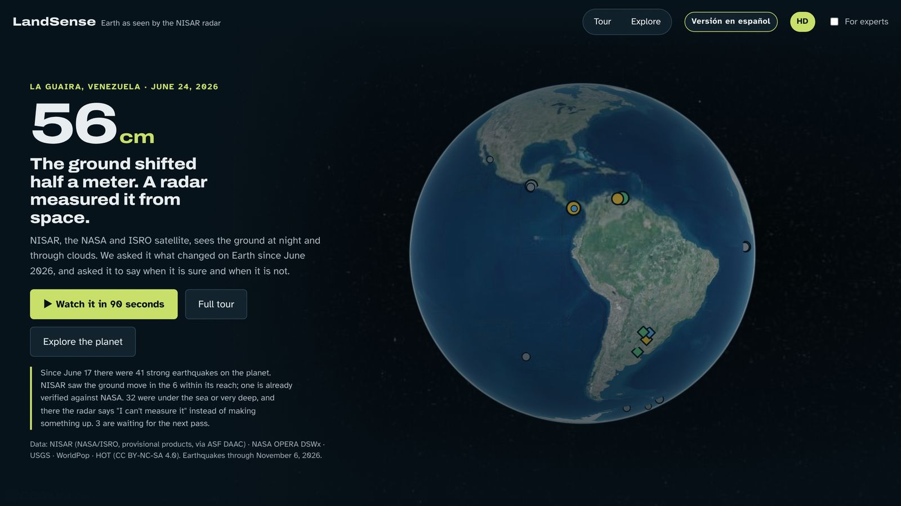
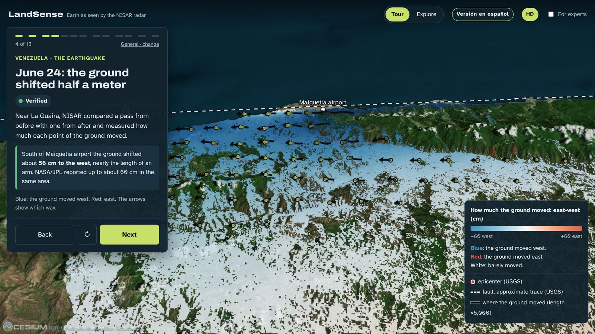
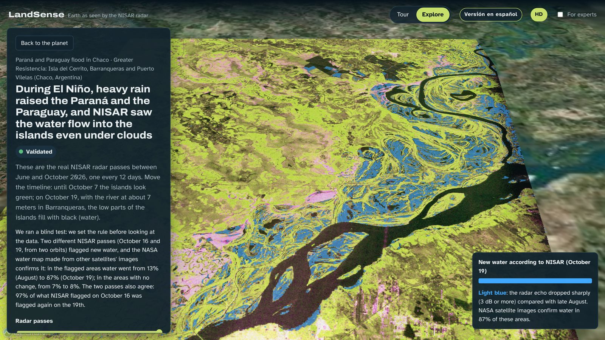
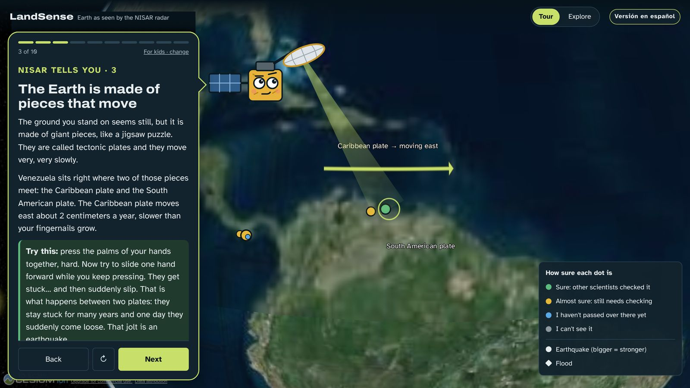

# LandSense

**The radar that tells you what changed on Earth, even through clouds, and how sure it is.**

LandSense is an interactive 3D web story and a set of open analysis scripts built on real data from **NISAR**, the NASA–ISRO L-band radar satellite. It detects two kinds of surface change, **ground motion from earthquakes** and **new water from floods**, checks every result against a no-event control and an independent source, and explains the findings to non-specialists with a confidence label on each one.

Built for the **NASA Space Apps Challenge 2026**, challenge *Dancing with the SARs*.

**Live app:** https://fedesina.github.io/landsense/



| Venezuela earthquake: which way the ground moved | Chaco flood: new water flagged by NISAR |
|---|---|
|  |  |

| Kids' version: NISAR tells its own story |  |
|---|---|
|  | Every screen is real NISAR data. The app runs in any browser, on desktop and mobile, in English (`?lang=en`) and Spanish. |

---

## What is in this repository

| Folder | What it is |
|---|---|
| `web/` | The interactive app: a 3D globe (CesiumJS) with a guided tour that plays by itself, three reading levels (kids 8–13, general, in detail), an "Explore" mode with every M6+ earthquake, "NISAR's eyes" (real radar images draped on the terrain) and a before/after slider. It shows **pre-computed results** stored in `web/puntos/` and `web/sismos.json`. |
| `src/` | The Python scripts that produced those results, from data search to the files the app reads. |

### Scripts in `src/`

| Group | Scripts, in run order | What they do |
|---|---|---|
| Venezuela earthquake (La Guaira) | `sismo_la_guaira_auditoria` → `sismo_la_guaira_controles` → `sismo_la_guaira_multiorbita` → `sismo_la_guaira_descomposicion` → `sismo_la_guaira_export_visor` → `sismo_la_guaira_poblacion` | Interferograms that cross the event, no-event controls, four orbits, east–west / vertical decomposition, export to the app, population near the rupture |
| Venezuela damage | `sismo_la_guaira_danio` → `sismo_la_guaira_danio_validacion` → `sismo_la_guaira_danio_export_visor` | Coherence loss in two orbits, check against field-verified damage (HOT), damage zones for the app |
| Any earthquake | `sismo_generico` (USGS event id) · `sismos_catalogo` → `sismos_export_visor` · `sismo_panama_export_visor` · `sismo_tibet_chequeo_hueco` → `sismo_tibet_export_visor` | Generic analysis with fixed checks, the global table of M6+ events, Panama and Tibet scenes |
| Water | `agua_gcov_exploratorio` → `agua_delta_firms` → `agua_delta_dswx` → `agua_delta_export_visor` · `agua_crecida_uruguay` · `agua_crecida_chaco` | Paraná Delta (fire ruled out, water confirmed with OPERA DSWx), Uruguay river and Chaco floods |
| Radar images | `radar_imagenes` · `radar_ojos_nisar_export` | Real NISAR GCOV images (HH, HV) composed and draped on the terrain ("NISAR's eyes") |

### What it can do, and what it can't

- **Earthquakes, any place in the world:** `src/sismo_generico.py` takes only a USGS event code. It finds the NISAR interferograms (GUNW) that cross the event date, measures ground motion, compares it against the previous pair (control) and runs fixed checks. Its automatic status is never higher than "unverified": a person still has to compare it with an independent source.
- **Floods:** `src/agua_crecida_uruguay.py` and `src/agua_crecida_chaco.py` flag new water from NISAR backscatter (GCOV) and confirm it with NASA OPERA water maps (DSWx). They use polarization: the cross-polarized HV echo comes mostly from vegetation (leaves and branches scatter the wave many times), and calm water acts as a mirror, so a cell is flagged when its HV echo drops by half or more (−3 dB). The study zones and dates are written in each script (`ZONAS`). Another river means adding a zone there, with the rules fixed **before** looking at the data.
- **The app does not analyse new events by itself.** It displays results exported by the scripts. Automatic runs on every new NISAR pass are future work.
- NISAR measures what already happened: it does **not** predict earthquakes. Water is mapped in ~100 m cells (flooded islands and wetlands, not a single street). Earthquakes under the sea or very deep leave no measurable signal on land.

## Results shown in the app

| Case | Finding | Status |
|---|---|---|
| Venezuela M7.5, 24 Jun 2026 | ~56 cm westward ground motion south of Maiquetía airport, ~2 cm vertical. Two independent orbits agree (r = 0.98); control pairs ~4 cm of noise. Consistent with NASA/JPL ("up to ~60 cm" west). | Verified |
| Venezuela, damage | Coherence loss in two orbits flags 97 zones (1 in the control), containing 248 of 328 field-verified collapsed buildings (HOT). A map of where to look first, not a building-by-building classifier. | Sensitivity validated against field data |
| Panama M7.7, 9 Oct 2026 | Two descending orbits agree (r = 0.99). Left-lateral slip and strike (~281°) consistent with USGS (288°). East–west numbers withheld: the ascending pass has unwrapping errors. | Seen, consistent with USGS |
| Paraná Delta, Aug 2026 | Water in NISAR-flagged cells ~5% → ~70% according to NASA OPERA DSWx-HLS, also confirmed by DSWx-S1. | Validated |
| Paraná/Paraguay at Resistencia (Chaco), Oct 2026 | Pre-registered blind test. Water in flagged cells 13% → 87% (DSWx-HLS); two NISAR orbits pass. | Validated |
| Tibet M7.0, 22 Oct 2026 | Two ascending orbits agree (r = 0.93 and 0.96) on tens of cm of line-of-sight motion around the epicentre; controls flat. No valid descending data, so vertical and sideways motion cannot be separated. The no-data area next to the rupture is mostly where the phase could not be unwrapped. | Seen, needs confirmation |
| 41 M6+ earthquakes (17 Jun – 6 Nov 2026) | 32 at sea or too deep to measure, 3 waiting for analysis or a pass, 5 seen, 1 verified. | Shown with their label |

## What you need (create your own accounts and keys)

Nothing secret is included in this repository. To run it you need:

| Need | For | Where to get it |
|---|---|---|
| **Cesium ion access token** (free) | The 3D globe: terrain and base map | https://ion.cesium.com → Access Tokens |
| **NASA Earthdata Login** (free) | Reading NISAR and OPERA data in `src/` | https://urs.earthdata.nasa.gov |
| **NASA FIRMS MAP_KEY** (free, optional) | Only `src/agua_delta_firms.py` (fire check in the Delta) | https://firms.modaps.eosdis.nasa.gov/api/map_key/ |
| Python 3.11 | Scripts in `src/` | `pip install -r src/requirements.txt` |

- **Earthdata:** the scripts call `earthaccess.login(persist=True)`. The first run asks for your Earthdata **username** (not your email) and password, and stores them in your own `~/.netrc`. Never commit that file.
- **FIRMS:** set the environment variable `FIRMS_API_KEY`, or put `FIRMS_API_KEY=...` in a `.env` file at the repository root. `.env` is ignored by git.

## Run the app

```bash
cd web
cp config.example.js config.js     # then paste your Cesium ion token inside
python -m http.server 8000         # or any static server (e.g. VS Code Live Server)
# open http://localhost:8000
```

Opening `index.html` by double-click does not work: the browser blocks reading local files. Without a valid token in `config.js`, terrain and base map do not load. For a public deployment, create a separate token restricted to that site's URL (Cesium ion → Allowed URLs).

## Run an analysis

```bash
pip install -r src/requirements.txt
python src/sismo_generico.py us6000t7zp     # Venezuela M7.5 (regression test)
python src/sismo_generico.py <USGS event id>
```

Outputs (figures, reports, intermediate arrays) are written to `data/processed/`, which is created locally and not versioned. NISAR products are read by streaming from NASA Earthdata cloud storage, not downloaded whole. The export scripts (`*_export_visor.py` and `radar_ojos_nisar_export.py`) need intermediate files produced first by the analysis scripts (order below). The app in `web/` already contains their outputs.

## How results are checked

1. **Detect** with NISAR, using thresholds fixed before looking at the result.
2. **Control:** run the same method on a pair of dates with no event. If the "signal" also appears there, it is an artifact.
3. **Confirm** with an independent source: USGS fault models, NASA OPERA water maps, field surveys.
4. **Label** every result: *unverified* → *verified* → *validated* (quantitative match with an independent source), or *retracted*. Our own early "105 cm" map of Venezuela turned out to be a processing artifact and was retracted.

## Data sources and credits

- **NISAR** L2 GUNW (interferograms) and GCOV (backscatter), provisional products. NASA/JPL and ISRO, distributed by the NASA Alaska Satellite Facility DAAC.
- **NASA OPERA** DSWx-HLS and DSWx-S1 surface water products, distributed by NASA PO.DAAC.
- **USGS** Earthquake Catalog (ComCat), moment tensors and finite-fault models.
- **WorldPop** 2020 population density (CC BY 4.0).
- **Humanitarian OpenStreetMap Team (HOT)**, field-validated damage points for La Guaira, published on HDX under **CC BY-NC-SA 4.0** (attribution kept in the app).
- **NASA FIRMS** active fire data (optional, `src/agua_delta_firms.py`).
- **CesiumJS** (Apache 2.0) and **Cesium ion** World Terrain and imagery (Cesium ion terms of use).
- Fonts: Archivo and Atkinson Hyperlegible (SIL Open Font License), via Google Fonts.

## Use of AI

Parts of the code, the app texts and the presentation were drafted with the help of an AI assistant (Claude, by Anthropic). All results were run on real data and reviewed by the team, following the checks above.

## License

Code and original content: **Apache License 2.0** (see `LICENSE` and `NOTICE`). Third-party data keep their own licenses, listed above.

Team LandSense · Argentina · NASA Space Apps Challenge 2026
